<p align="center">
  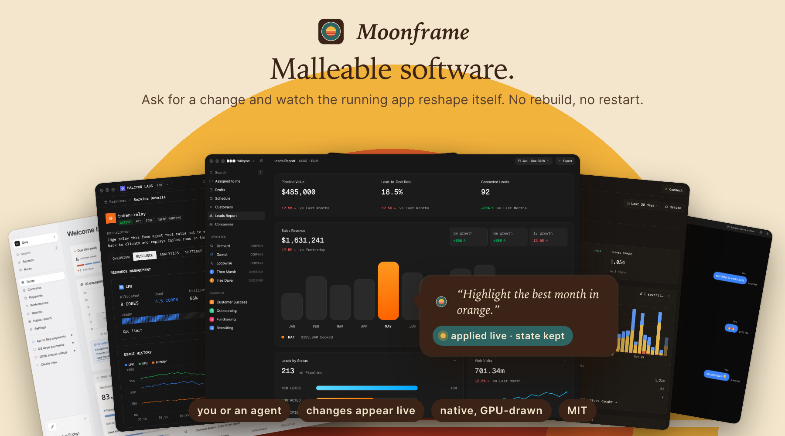
</p>

<h1 align="center">Moonframe</h1>

<p align="center">
  <a href="https://moonframe.dev"><b>moonframe.dev</b></a> ·
  <a href="https://docs.moonframe.dev"><b>Documentation</b></a>
</p>

<p align="center">
  <a href="#install"><b>Install</b></a> ·
  <a href="#quick-start"><b>Quick start</b></a> ·
  <a href="#make-it-yours">Make it yours</a> ·
  <a href="#building-blocks">Building blocks</a> ·
  <a href="#working-with-an-agent">Working with an agent</a> ·
  <a href="#mods-from-git">Mods from git</a> ·
  <a href="#whole-apps-as-profiles">Apps</a> ·
  <a href="#example-apps">Example apps</a> ·
  <a href="#your-own-app-on-the-library">Library</a> ·
  <a href="#commands">Commands</a> ·
  <a href="#license">License</a>
</p>

A factory for native desktop apps you reshape while they run. Each app's
whole window is written in [Luau](https://luau.org): Rust and
[GPUI](https://www.gpui.rs) draw it, check it, and keep it safe, and every
panel, split, toolbar and status bar is a Luau file that reloads as you save,
with its state kept. Ask an agent for a change, or make it by hand, and the
running app reshapes itself, even from inside the app: its **Send feedback**
button hands what you write to a coding agent, which changes the app in front
of you.

Moonframe starts you off with an app of its own, ready to change, and builds
whole new ones beside it: each runs as a profile of its own and ships as a
standalone release. `examples/` holds 25 of them, from a mail client to an
infra console, all in one gallery with `just demo`. A Rust app can also use
Moonframe as a library.

## Gallery

<p align="center">
  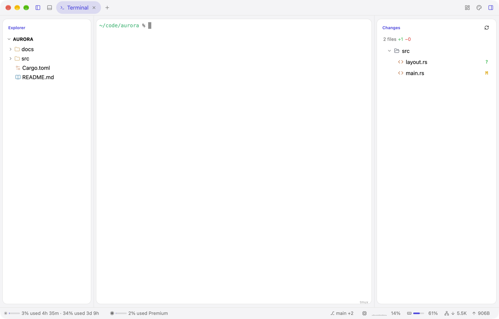
  <br>
  <sub><b>The window that ships.</b> Every part of it is a mod in <code>app/mods/</code>: the explorer, the terminal tabs, the changes and their diffs, and the status bar widgets, whose CPU, memory and git data come from providers. <b>+</b> opens more tabs: terminals, browsers, files; a markdown file opens in an editor with a live preview.</sub>
</p>

<table>
  <tr>
    <td width="50%" valign="top">
      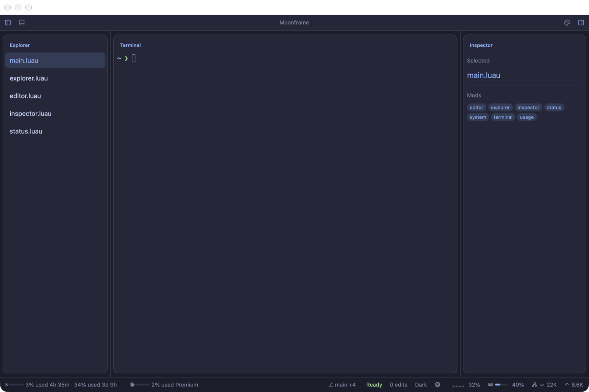
      <br>
      <sub><b>Themes.</b> Pick one of the bundled color schemes from the palette button or <b>View &gt; Themes…</b>; the window, its controls and the terminals all follow it. On <a href="https://omarchy.org">Omarchy</a> the desktop's theme is the default, and changes with it. <code>style.luau</code> restyles anything on top.</sub>
    </td>
    <td width="50%" valign="top">
      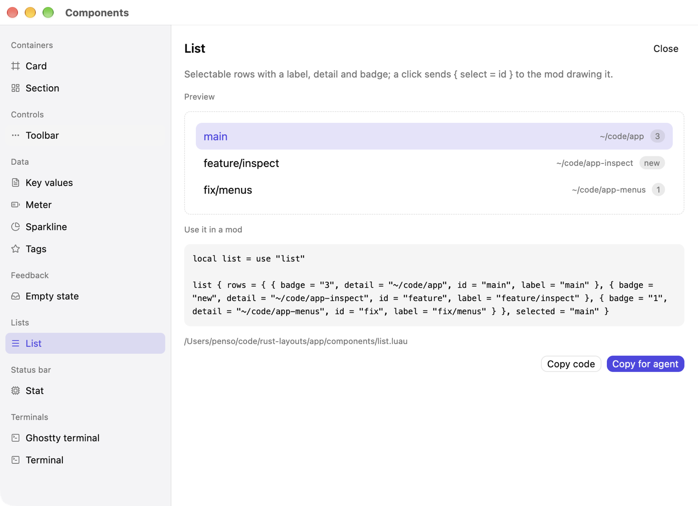
      <br>
      <sub><b>Components.</b> Ready-made pieces mods <code>use</code>, browsed from <b>View &gt; Components…</b> in Developer Mode with a live preview, the code to paste, and <b>Copy for agent</b>.</sub>
    </td>
  </tr>
</table>

<p align="center">
  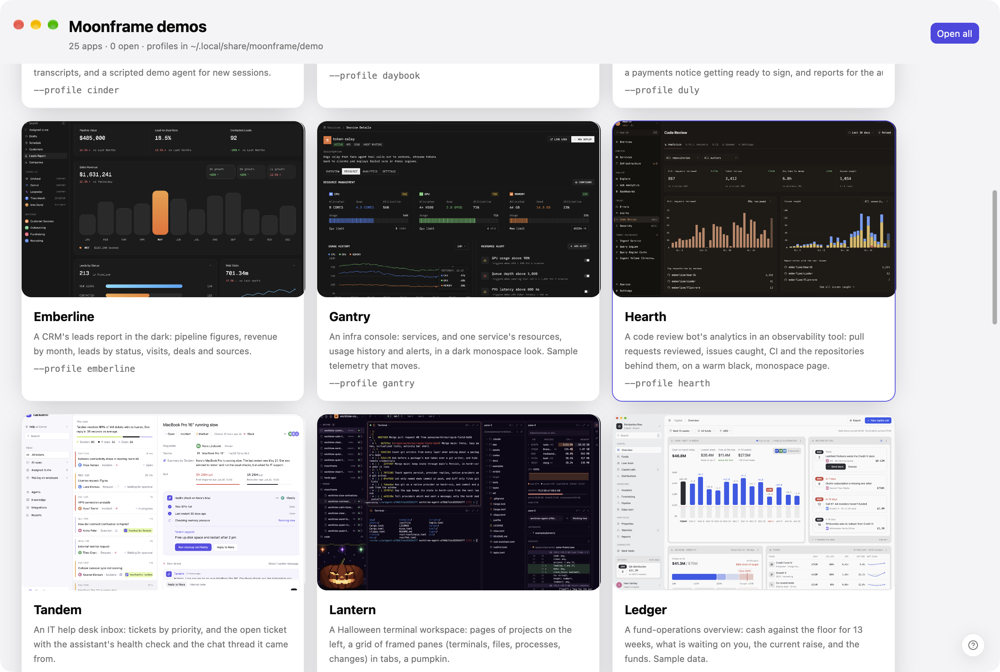
  <br>
  <sub><b>The example apps</b>, in the gallery <code>just demo</code> opens: a click opens one as a window of its own, beside the others. See <a href="#example-apps">Example apps</a>.</sub>
</p>

## What you get

- **A window laid out in Luau.** A shell (`app/main.luau`) places regions,
  and mods fill them. Each mod is one file with its own state, `init`,
  `update` and `view`, like an Elm program; mods talk with messages.
- **Live reload.** Save a file and the window redraws in place, keeping each
  mod's state. A mistake never blanks or shifts the window: a bad element
  shows as a small warning mark, and a broken mod keeps its last good view.
- **A stylesheet.** Colors, corners, shadows, spacing, fonts and animations
  in `app/style.luau`, with rules by element type and class, hover states,
  transitions on panels, and styles a mod brings for itself.
- **Over 140 components** that mods share with `use "name"`: tabs, tables,
  charts, a command palette, a markdown editor, dialogs, sheets, toasts,
  calendars, chat messages and more, each with a live preview in the
  Components window.
- **Terminals.** `ui.terminal` runs your login shell on
  [`alacritty_terminal`](https://crates.io/crates/alacritty_terminal) or on
  Ghostty's [libghostty-vt](https://crates.io/crates/libghostty-vt). With
  herdr-core or tmux installed, terminals keep running after the app quits
  and come back on the next launch.
- **Providers** for data Luau can't reach, publishing what views read as
  `app.<name>`: sandboxed WebAssembly (WASM) components, plain processes, or Rust
  built into the app. The built-in ones cover git (status, diffs, commit and
  push), GitHub and GitLab, the project's files and markdown documents, the
  system's load, and coding agents.
- **Coding agents in the app.** The `acp` provider runs Claude, Codex,
  Gemini, OpenCode or Copilot over the
  [Agent Client Protocol](https://agentclientprotocol.com) for any mod, and
  `agent-run` shows what each is doing: its plan, tool calls, permission
  questions and answer.
- **State that lasts.** Each mod's state is kept in SQLite across launches,
  and survives a reload.
- **An inspector.** <b>View &gt; Inspect Element</b> picks anything in the
  window, like a browser's developer tools, and tells an agent which file
  and line drew it.
- **Your folder over the app.** `~/.config/moonframe` holds your own mods,
  providers and stylesheet, laid over the built-in app; updates never touch
  it, and mods install from git into it. A file there wins over the app's at
  the same path, so to change a built-in one, copy it there: the window
  reloads with the copy, and removing it brings the app's back. The installed
  app itself stays signed: agents are kept out of it and work on such copies.
  `moonframe doctor` names what in your folder breaks the app, `--fix` moves
  it aside, and `--rollback` goes back to the newest snapshot that loads. An
  agent's whole run can be undone from Send feedback, or with
  `moonframe history undo --run`.
- **A skill for agents** in `.claude/skills/moonframe` that teaches them to
  build with all of the above. The app offers to copy its skills to
  `~/.config/moonframe/.claude/skills` (only if you agree, and again when an
  update brings newer ones), so an agent working on your own mods knows
  them too.
- **A sandbox.** Luau runs with no files, network or process access, a
  memory cap and an instruction budget; anything that reaches the machine
  goes through a provider or an element the host owns. WASM
  providers run sandboxed too, so a provider you install from someone else
  can have no access to your machine at all. See
  [What runs with what access](#what-runs-with-what-access).

## Install

On macOS 13 or later, with [Homebrew](https://brew.sh):

```sh
brew install moonframehq/tap/moonframe
```

This installs `Moonframe.app` in `/Applications` and the `moonframe` command.
Linux and Windows builds are on the
[releases page](https://github.com/moonframehq/moonframe/releases). To change
Moonframe itself rather than build on it, start from the source instead.

## Quick start

You need Rust (the version in `rust-toolchain.toml` is picked up by rustup)
and [just](https://github.com/casey/just). [mise](https://mise.jdx.dev)
installs the rest from `mise.toml`.

```sh
git clone https://github.com/moonframehq/moonframe my-app
cd my-app
mise install        # Rust, and Zig for the Ghostty terminal
just run            # opens the window on app/
```

Now edit `app/mods/explorer/main.luau` or `app/style.luau` and save: the
window changes as you type. `just check` loads everything without a window
and points at any problem, and `just types` type-checks the Luau.

The Ghostty terminal builds libghostty-vt from source with Zig 0.17 (pinned
in `mise.toml`). To build without it, use
`cargo run -p moonframe-app --no-default-features --features moonframe/default`.
For a lean app, select only its capabilities; see
[feature flags](docs/library.md#choosing-capabilities).

Moonframe is developed on macOS. CI builds, lints and tests it on macOS,
Linux (x86_64 and ARM64) and Windows (x86_64), and each release ships a macOS disk
image, Linux tarballs and Windows zips, with checksums, Sigstore signatures
and GitHub attestations; see [docs/releasing.md](docs/releasing.md).

## Make it yours

Moonframe is meant to be copied and renamed:

1. **The app.** Replace what's in `app/`: `main.luau` lays out the window,
   `mods/` fills it, `style.luau` styles it. Keep what helps and delete the
   rest; the explorer, the tabs and the changes are a place to start.
2. **The name.** The crate names and `repository` in `Cargo.toml`, the
   app id `APP_ID` and the user folder's name (`Identity::starter`) in
   `crates/moonframe-packages/src/lib.rs`, the bundle's name in
   `scripts/bundle-app.sh`, and the title in `app/main.luau`.
3. **The icon.** `assets/icon.png`, drawn by `scripts/draw-icon.swift`.
4. **Ship it.** `just bundle` builds a `.app` with your app inside, and
   `just install` puts it in `/Applications`.

## Building blocks

A mod is a folder with one file:

```lua
-- app/mods/counter/main.luau
return mod {
	region = "left",

	init = function(previous)
		return previous or { count = 0 }
	end,

	update = function(state, msg)
		if msg == "add" then
			state.count += 1
		end
	end,

	view = function(state, app)
		return ui.panel {
			title = "Counter",
			ui.text(`Clicked {state.count} times`),
			ui.button { "Add", msg = "add", variant = "primary" },
		}
	end,
}
```

Save it and it appears in the left region. From there:

| Need | Write |
| --- | --- |
| A look | a rule in `style.luau`: `panel = { radius = 12, shadow = "0 4px 12px #0003" }` |
| A reusable piece | `components/<name>.luau`, used with `local stat = use "stat"` |
| A shell | `ui.terminal { id = "main", cwd = "~/code" }` |
| Data from the machine | a provider in `providers/<name>/`, read as `app.<name>` |
| A sheet or menu | `ui.popover { open = state.open, dismiss = "close", content = sheet, widget }` |
| A new kind of element | Rust in `crates/`, the one change that needs a rebuild |

The skill in `.claude/skills/moonframe/SKILL.md` is the full reference:
every element, the stylesheet, components, terminals, providers, and
recipes.

### How it is laid out

```text
app/                    the built-in app: shell, mods, components, providers, style
crates/moonframe-core/  reads Luau into checked element trees, styles, components
crates/moonframe/       the library: the window, drawn with GPUI, inspector, menus
crates/moonframe-app/   the `moonframe` binary: the starter, on the library
crates/moonframe-providers/  runs Wasm, process and native providers
crates/moonframe-packages/   installs packages, finds profiles, updates and bundles
crates/moonframe-terminal/   shells on alacritty_terminal and libghostty-vt
crates/moonframe-mux/   keeps terminals in herdr-core or tmux, else a local pty
crates/moonframe-store/ the state kept across launches, in SQLite
crates/moonframe-git/   the native git provider
crates/moonframe-acp/   coding agents over the Agent Client Protocol
crates/moonframe-docs/  reads and saves the project's documents for the editor
examples/               apps built on it, and a package they share
types/moonframe.d.luau  types for the Luau API, used by `just types` and editors
wit/provider.wit        the interface a Wasm provider implements
```

## Working with an agent

The window reloads while an agent edits it, so you can watch it work.

- **An agent in a tab.** From any terminal,

  ```sh
  moonframe pane new --agent claude "add a clock to the status bar"
  ```

  opens a terminal tab in the running window (opening the app if it
  isn't), in your folder, `~/.config/moonframe` (the profile's with
  `--profile`), and starts the agent there with your prompt. You watch it
  work in the tab while the window changes beside it. `--cwd DIR` starts it
  somewhere else, and without `--agent` the tab is a plain shell. The app
  types the command into your login shell, so the agent runs as you, with
  your settings.
- **Send feedback.** The `?` in the title bar (or in a corner of an example
  app) opens a box: write what should change, attach an element picked with
  Inspect if it helps, and send. Or press Copy on the picked element and
  paste it into an agent of your own. ⇧⌘X (Ctrl-Shift-X elsewhere) goes
  straight to picking: click an element, choose its level in the card,
  and Enter opens the box with it attached; set `inspect_shortcut` in `settings.toml` to use another key,
  or `""` for none. The window follows that file as it changes. A coding agent in the background changes
  that app's own files with every permission, checks them, then screenshots
  your window and looks at the result before it answers; the window reloads
  with the change. Each request becomes a conversation under **Feedback &
  fixes**, so when something is not quite right you reply and the agent
  carries on from there.
- **The skill.** Claude Code picks up `.claude/skills/moonframe`, which
  tells an agent where a feature belongs, how to build it, and how to check
  it with `just check` and `just types`.
- **"Add it here."** <b>View &gt; Inspect Element</b> (⌥⌘I), click an
  element (↑ and ↓ first for the row, list or panel around it), and say
  "add a list of branches here". The selection, with its
  file and line, is saved where the agent reads it.
- **Pick a component.** In the Components window, <b>Copy for agent</b>
  copies a request to add that component at your selection.
- **See it before it is made.** Ask for ideas ("show me three takes on the
  status bar") and the `moonframe-mockups` skill draws them live, side by
  side, in a Mockups tab of your window. <b>Pick</b> copies your choice for
  the agent; nothing real changes until then.

## Mods from git

Mods and providers can live in their own repositories and install into your
folder:

```sh
moonframe mod new ~/code/my-mod               # a git repo with one mod and a README
moonframe mod link ~/code/my-mod              # use it in place, editing live
moonframe mod install github.com/owner/repo   # or owner/repo, a git URL, a folder; @ref pins it
moonframe mod list | update | remove NAME | enable NAME | disable NAME
```

Packages ship source only, so everything they run can be read first.

## What runs with what access

| Code | Runs | Can reach |
|---|---|---|
| Mods (Luau) | in the host's Luau sandbox, with memory and instruction caps | only the elements and providers the host offers |
| WASM providers (`kind = "wasm"`) | on [wasmtime](https://wasmtime.dev), with 64 MiB and a fresh instruction budget per call | only the host calls listed under `capabilities` in `provider.toml` (today `system`, the machine's load) |
| Process and native providers | as your user | anything you can: git, forges, coding agents, your files |

Write a provider as a WASM component if it only shapes data or if it comes
from someone else. A bug or bad actor in it can't read your files or reach
the network. Keep process and native providers for things the sandbox
can't reach, and read them as you would any script.

The sandbox only covers the running component. Building it runs Cargo as
your user, including proc macros and dependency build scripts. The host
refuses build scripts in the provider or its local crates, and toolchains
named by path, and runs Cargo outside its folders, so no Cargo config there
applies. It also refuses any package that ships a binary, so what runs is
always source you can read. Bundled apps ship their WASM providers prebuilt
and build nothing on your machine.

Apps with no WASM providers can turn off the `wasm` feature, which is on by
default (see [docs/library.md](docs/library.md)).

**Build one:** [Building WebAssembly (WASM) providers](https://docs.moonframe.dev/wasm-providers/)
walks through a complete Rust component, Luau messages, live reload and
packaging, for people and coding agents. [Markdown source](docs/wasm-providers.md).

## Whole apps as profiles

The starter stays as it is; a whole other app installs beside it as a
profile, with its own shell, mods, packages and theme, and runs as an app of
its own:

```sh
moonframe app install github.com/owner/some-app   # clones it and what it requires
moonframe --profile some-app                      # opens it
moonframe app new ~/code/my-app                   # start one: moonframe.toml, a shell, a mod, agent skills
moonframe app link ~/code/my-app                  # run it in place, editing live
moonframe app list | update NAME | remove NAME
```

An app is a repository laid out like `app/`, with a `moonframe.toml`:

```toml
[app]
name = "my-app"                  # the profile it installs as
title = "My App"                 # its name in the menu bar and bundle
icon = "icon.png"                # its icon (default icon.png)
keep = ["terminal"]              # built-in mods it shows; it brings the rest
requires = ["owner/repo@v1"]     # packages it installs with it, or "../shared"
version = "1.0.0"                # its version, for its bundle and updates
updates = "owner/my-app"         # the GitHub repository it is released from
```

With `updates`, the app menu gets **Check for Updates…**, which offers the
repository's newest GitHub release and, on macOS, installs it over the app's
bundle; see [docs/updates.md](docs/updates.md).

The built-in providers, components and styles are there for it to use; the
built-in mods are not, unless it keeps them. Profiles live in
`~/.config/moonframe/profiles/`, and your own `style.luau` follows you
into each.

`just bundle-app NAME` builds a profile's app as a standalone release:
`target/bundle/<Title>.app` on macOS, or a prefix with a `.desktop` file
on Linux, with the app's title, id and icon. A bundle starts with
Developer Mode off: no Components…, Inspect Element or Reload. **Developer
Mode** in the app menu turns them on live, for anyone who wants to change
their app, and the choice is kept; `--release` and `--dev` set it for one
run. Outside a release,
**Build App Bundle** in the app menu builds the window's own app the same
way and shows it in Finder.

An app's `main.luau` can also add `menus` to the menu bar, with
shortcuts, and say what its About panel shows (`about = { version,
description, website, copyright }`); the menu bar carries the app's title.

### Example apps

`examples/` holds apps built this way, each with its own name, icon, menus,
About panel and Send feedback button. The dashboards and chats run on sample
data or a scripted agent, labelled as such.

`just demo` opens them all in one gallery (the screenshot at the top): a
picture of each, and a click opens it as a window of its own, or brings it
forward; **Open all** opens every one to compare them. Their profiles go in
`~/.local/share/moonframe/demo`, so your own folder stays as it is. Each app
runs from its folder in place, so a change, yours or an agent's from Send
feedback, shows at once.

<table>
  <tr>
    <td width="50%" valign="top">
      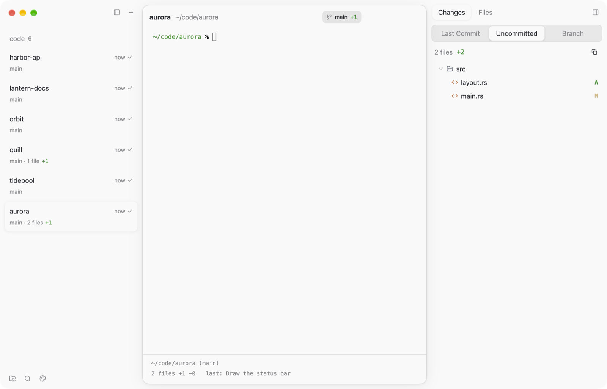
      <br>
      <sub><b>Sessions</b> (<code>sessions</code>): coding sessions across your repositories, each with a shell, its branch, and its changes by commit, uncommitted or branch.</sub>
    </td>
    <td width="50%" valign="top">
      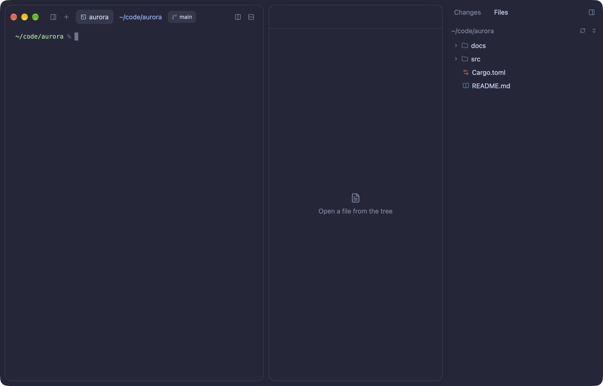
      <br>
      <sub><b>Workbench</b> (<code>workbench</code>): a terminal, an editor and the project's files, in tabs and splits.</sub>
    </td>
  </tr>
  <tr>
    <td width="50%" valign="top">
      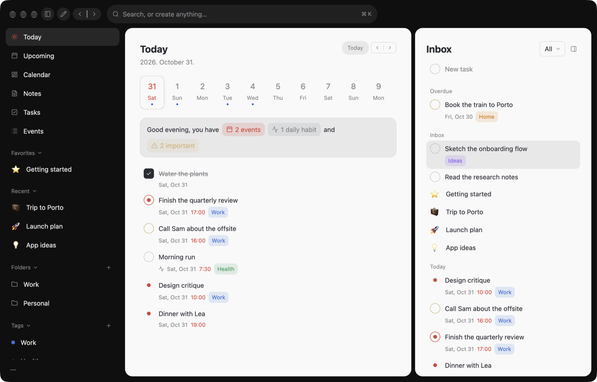
      <br>
      <sub><b>Daybook</b> (<code>daybook</code>): a planner with today's tasks and events, an inbox, a month, notes, and three looks.</sub>
    </td>
    <td width="50%" valign="top">
      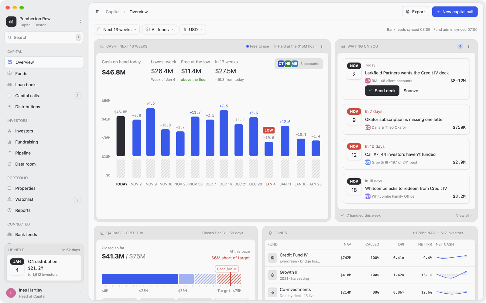
      <br>
      <sub><b>Ledger</b> (<code>ledger</code>): a fund overview: cash against a floor, what is waiting on you, a raise, and funds with their curves.</sub>
    </td>
  </tr>
  <tr>
    <td width="50%" valign="top">
      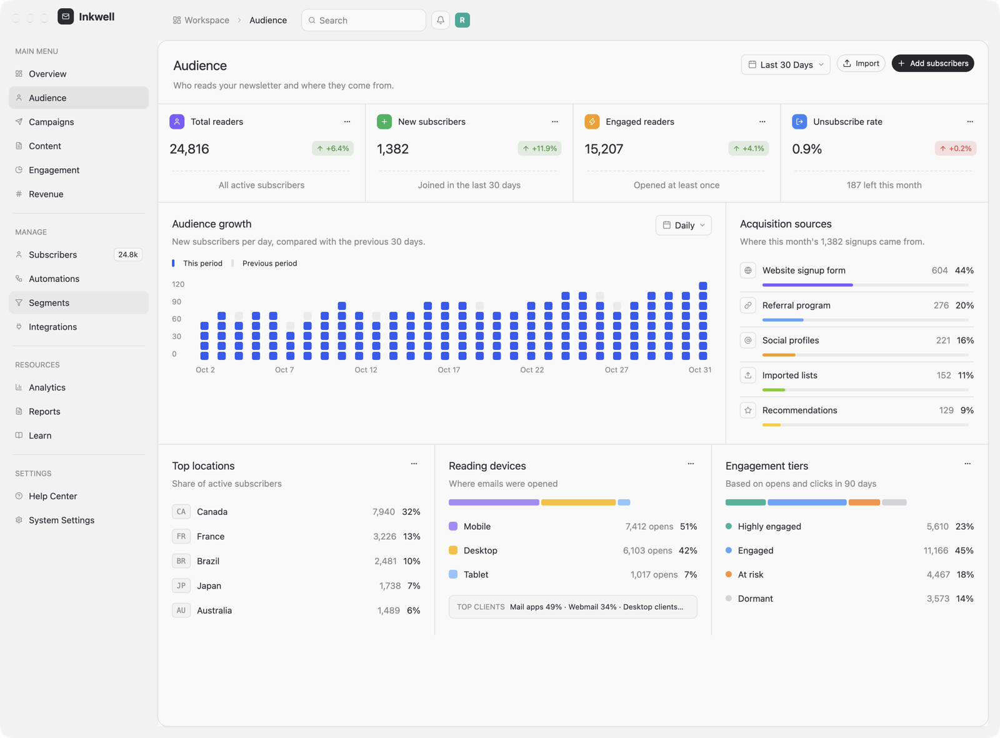
      <br>
      <sub><b>Inkwell</b> (<code>audience</code>): a newsletter's audience: KPIs, signups per day, where readers come from, and how engaged they are; and Learn, with courses, lessons, guides and live sessions.</sub>
    </td>
    <td width="50%" valign="top">
      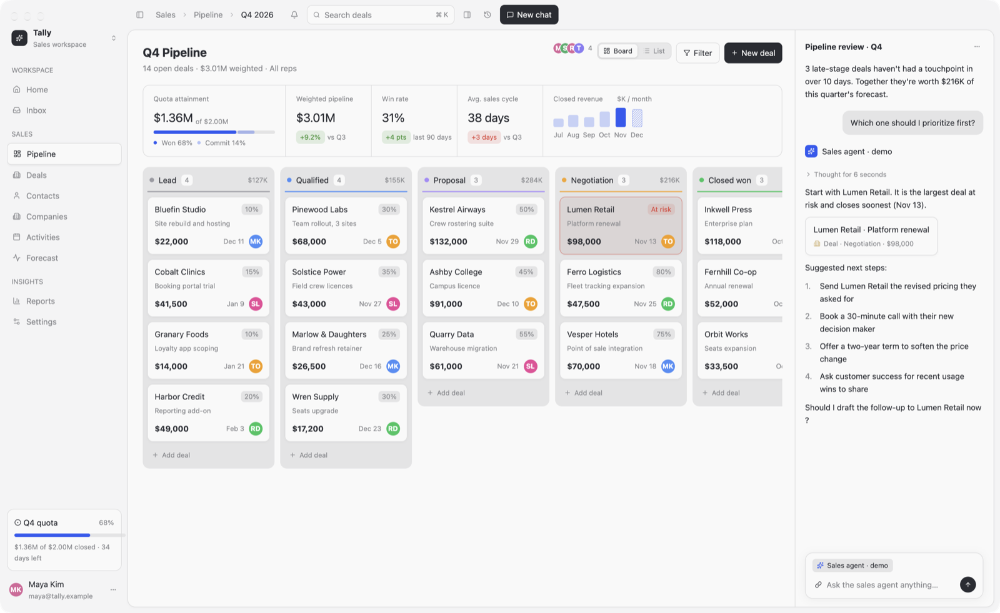
      <br>
      <sub><b>Tally</b> (<code>pipeline</code>): a sales kanban with KPIs, deal cards, a list view, a week of meetings, and a scripted agent panel labelled demo.</sub>
    </td>
  </tr>
</table>

<p align="center">
  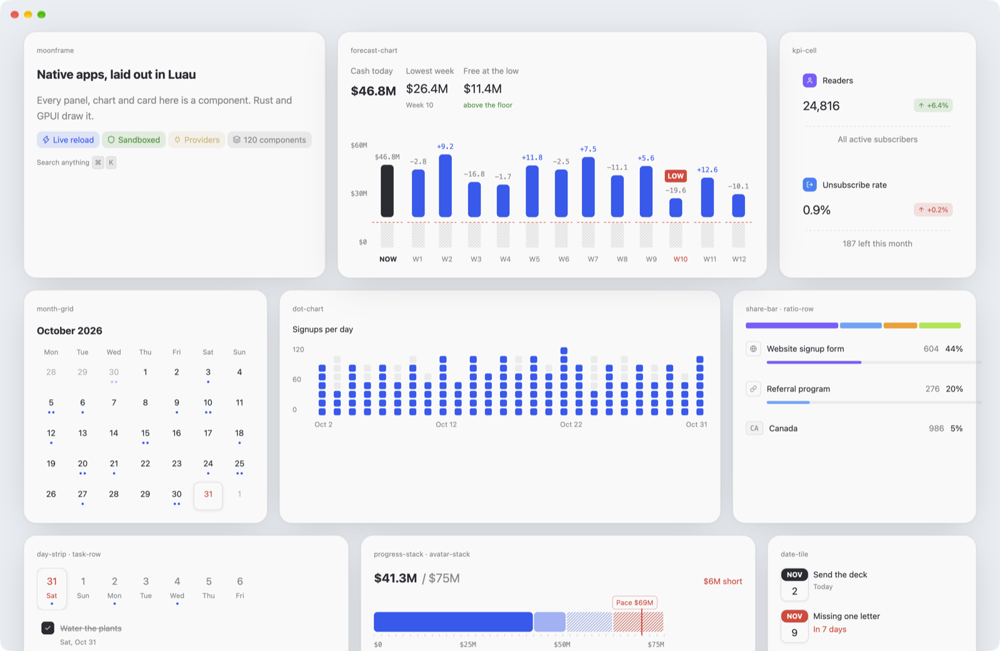
  <br>
  <sub><b>Stage</b> (<code>stage</code>): the components on a bento board, with sample data, for stills. View hides the captions and changes the backdrop.</sub>
</p>

<p>More, each a study of a kind of app:</p>

<table>
  <tr>
    <td width="50%" valign="top">
      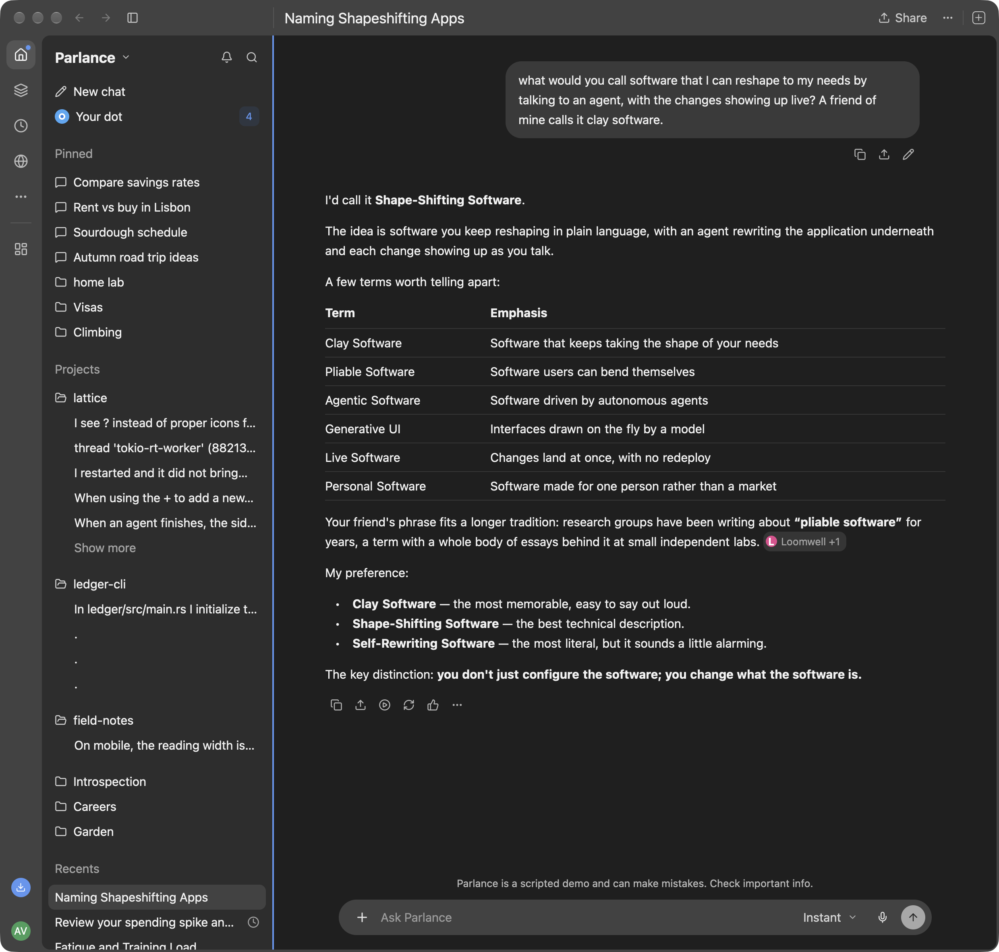
      <br>
      <sub><b>Parlance</b> (<code>parlance</code>): a desktop chat app with a scripted demo agent: chats, pinned chats and folders, projects and recents in a sidebar, rich markdown answers that stream in.</sub>
    </td>
    <td width="50%" valign="top">
      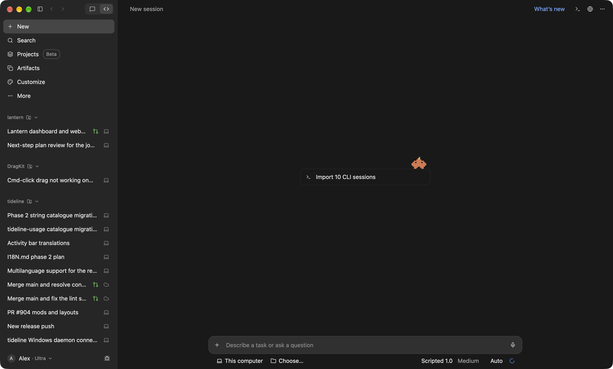
      <br>
      <sub><b>Cinder</b> (<code>cinder</code>): a desktop agent app in code mode: your coding-agent CLI sessions grouped by repository (read-only), their transcripts, and a scripted demo agent for new sessions.</sub>
    </td>
  </tr>
  <tr>
    <td width="50%" valign="top">
      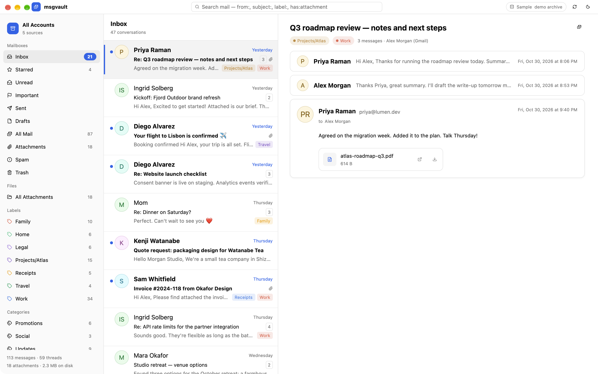
      <br>
      <sub><b>msgvault</b> (<code>msgvault</code>): a reader for a msgvault archive (mail, chats, calendar), after msgvault-gpui.</sub>
    </td>
    <td width="50%" valign="top">
      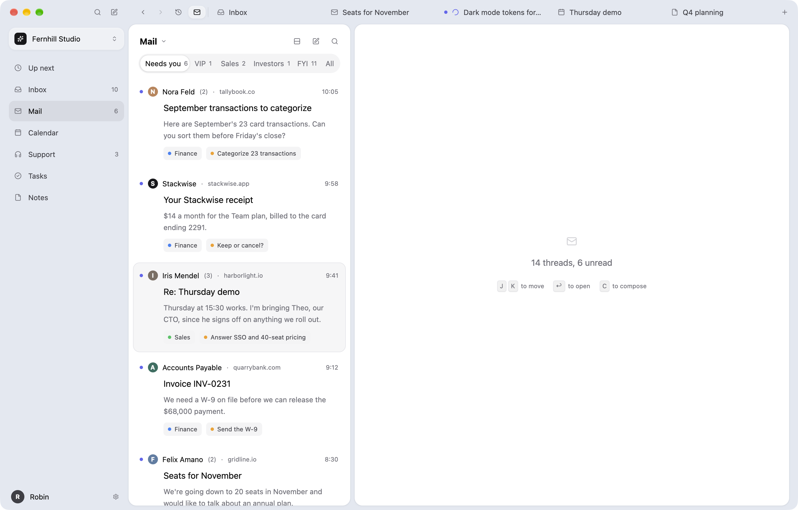
      <br>
      <sub><b>Tidings</b> (<code>tidings</code>): a mail client in two layouts: the list beside the open email, or one line per email across the window.</sub>
    </td>
  </tr>
  <tr>
    <td width="50%" valign="top">
      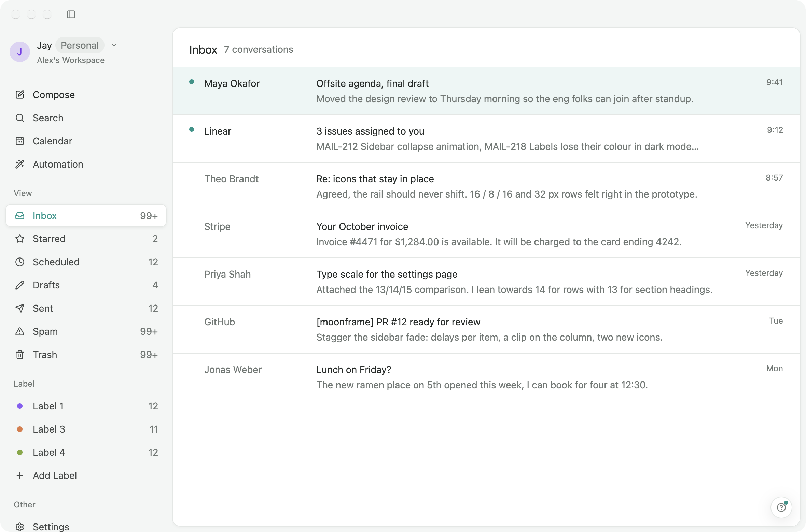
      <br>
      <sub><b>Mailbox</b> (<code>mailbox</code>): a mail client's frame: a sidebar of folders and labels that folds to an icon rail (labels fade out one after another, the icons stay put) and the folder's messages beside it. Sample data.</sub>
    </td>
    <td width="50%" valign="top">
      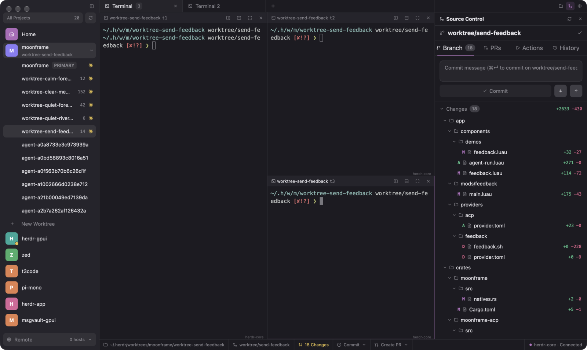
      <br>
      <sub><b>Trellis</b> (<code>trellis</code>): a terminal multiplexer around projects and their work trees: each work tree keeps its own tabs of split terminals, with its source control beside them.</sub>
    </td>
  </tr>
  <tr>
    <td width="50%" valign="top">
      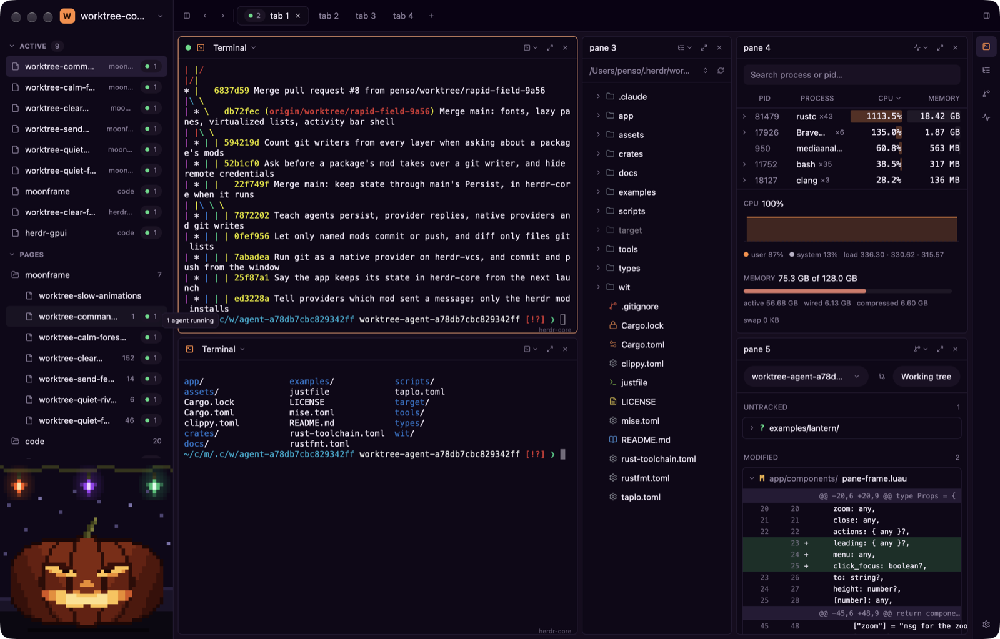
      <br>
      <sub><b>Lantern</b> (<code>lantern</code>): a Halloween terminal workspace: pages of projects on the left, a grid of framed panes (terminals, files, processes, changes) in tabs, a pumpkin.</sub>
    </td>
    <td width="50%" valign="top">
      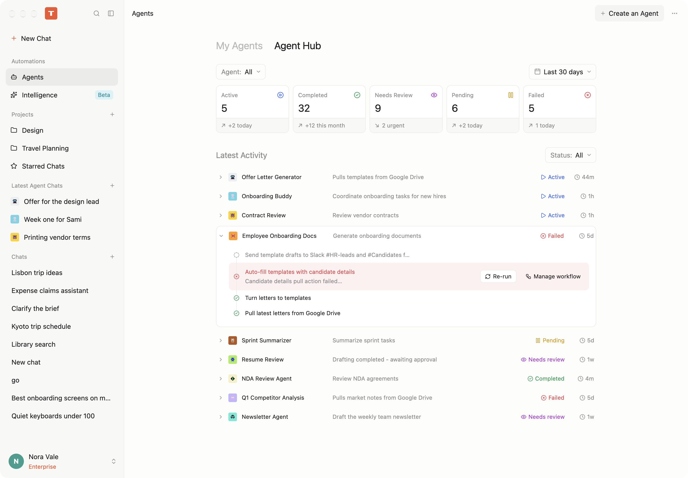
      <br>
      <sub><b>Tessel</b> (<code>tessel</code>): an agents hub: your agents as pixel-icon cards or a table, the hub's runs with their steps, and a workflow to fix a failed one. Sample data.</sub>
    </td>
  </tr>
  <tr>
    <td width="50%" valign="top">
      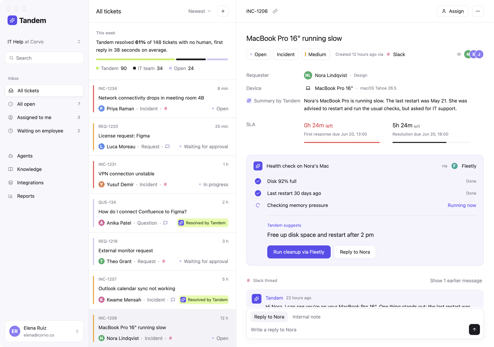
      <br>
      <sub><b>Tandem</b> (<code>helpdesk</code>): an IT help desk inbox: tickets by priority, and the open ticket with the assistant's health check and the chat thread it came from.</sub>
    </td>
    <td width="50%" valign="top">
      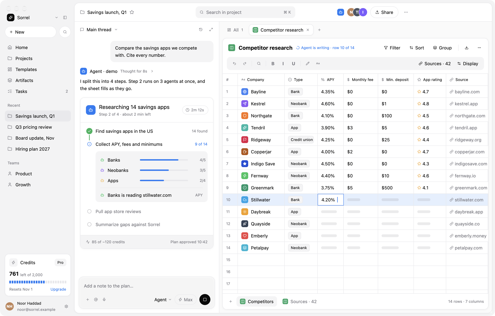
      <br>
      <sub><b>Sorrel</b> (<code>research</code>): an agent's research workspace: a thread with the agent's plan on the left, the sheet it fills cell by cell on the right (a scripted, labelled demo).</sub>
    </td>
  </tr>
  <tr>
    <td width="50%" valign="top">
      
      <br>
      <sub><b>Cadence</b> (<code>cadence</code>): a workflow automation dashboard: runs, success, tokens, the active workflows and templates, and a notification drawer behind the bell. Sample data.</sub>
    </td>
    <td width="50%" valign="top">
      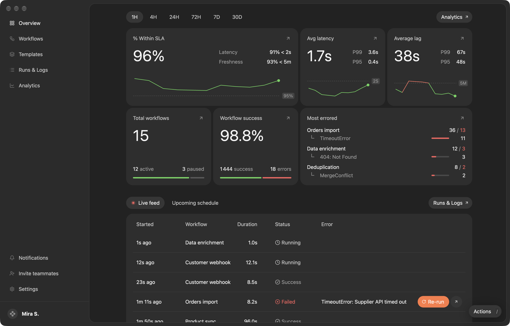
      <br>
      <sub><b>Vigil</b> (<code>vigil</code>): workflow operations at a glance: time within SLA, latency and lag against their limits, what fails most, and a live feed of runs as they start and finish.</sub>
    </td>
  </tr>
  <tr>
    <td width="50%" valign="top">
      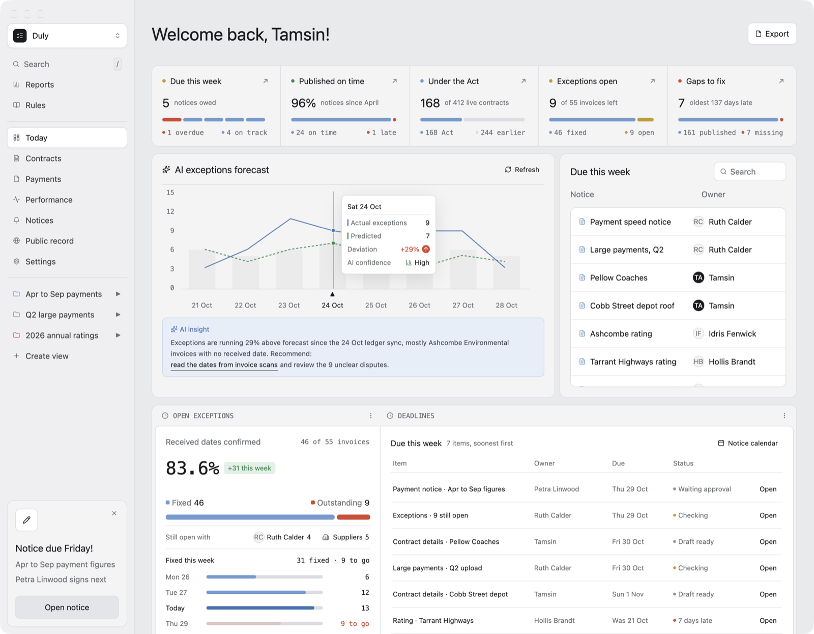
      <br>
      <sub><b>Duly</b> (<code>duly</code>): compliance notices for a public buyer: what is due this week, exceptions against the forecast, the contract register, a payments notice getting ready to sign, and reports for the audit committee. Sample data.</sub>
    </td>
    <td width="50%" valign="top">
      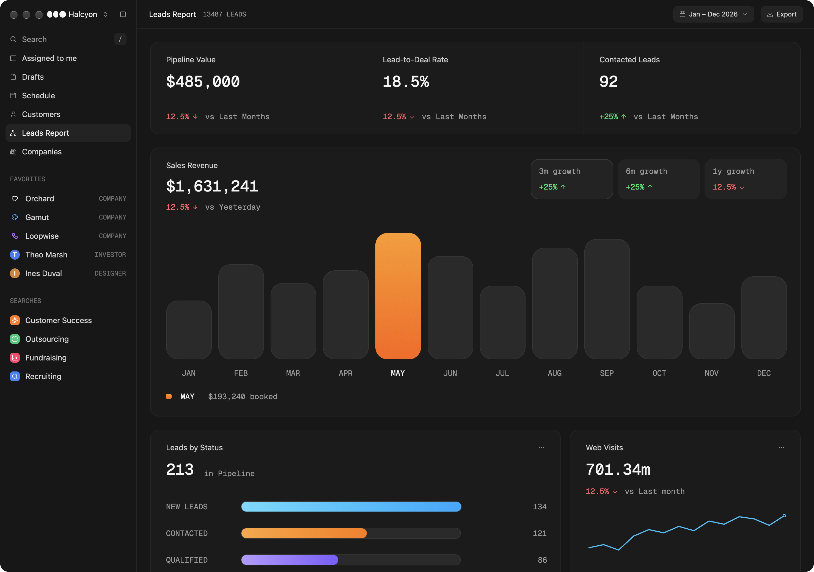
      <br>
      <sub><b>Emberline</b> (<code>emberline</code>): a CRM's leads report in the dark: pipeline figures, revenue by month, leads by status, visits, deals and sources.</sub>
    </td>
  </tr>
  <tr>
    <td width="50%" valign="top">
      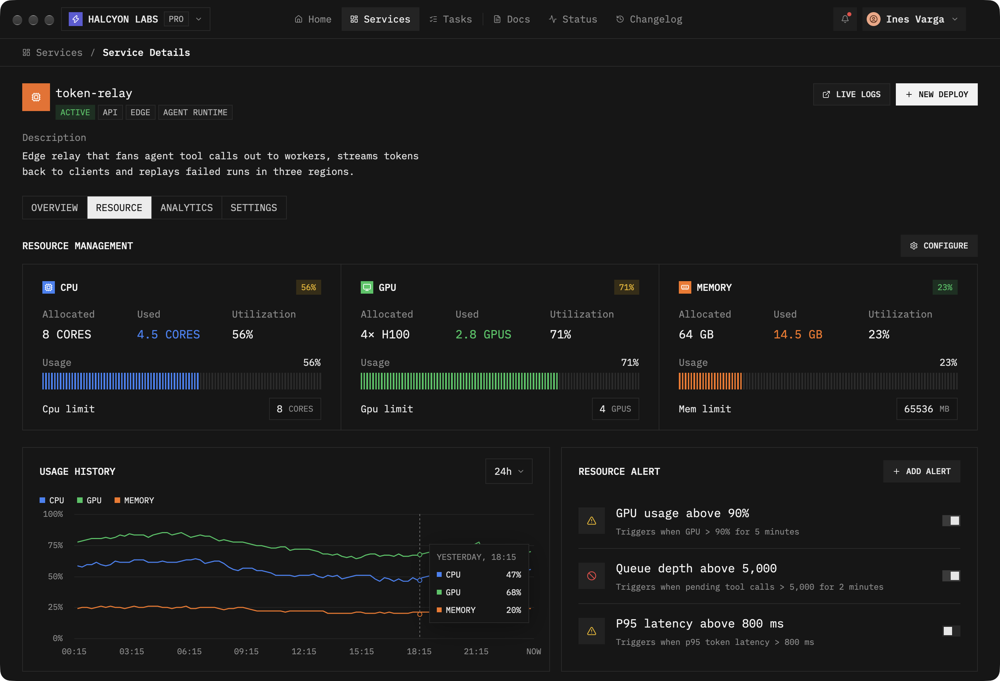
      <br>
      <sub><b>Gantry</b> (<code>gantry</code>): an infra console: services, and one service's resources, usage history and alerts, in a dark monospace look. Sample telemetry that moves.</sub>
    </td>
    <td width="50%" valign="top">
      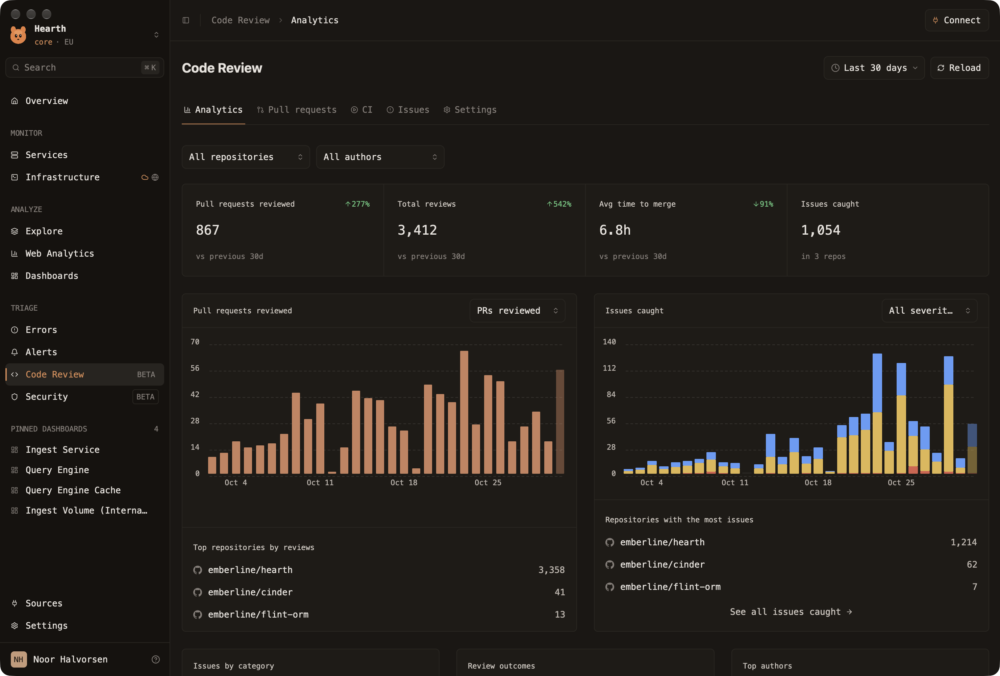
      <br>
      <sub><b>Hearth</b> (<code>hearth</code>): a code review bot's analytics in an observability tool: pull requests reviewed, issues caught, CI and the repositories behind them, on a warm black, monospace page.</sub>
    </td>
  </tr>
  <tr>
    <td width="50%" valign="top">
      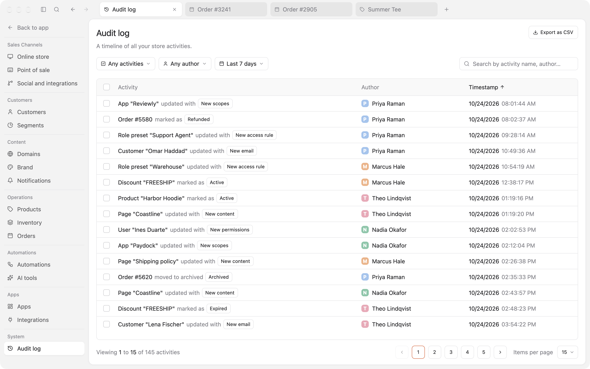
      <br>
      <sub><b>Storefront</b> (<code>storefront</code>): a store's admin with its audit log: browser-style tabs in the title bar, grouped settings in the sidebar, and a filterable, paged table of every activity. Sample data.</sub>
    </td>
    <td width="50%" valign="top">
      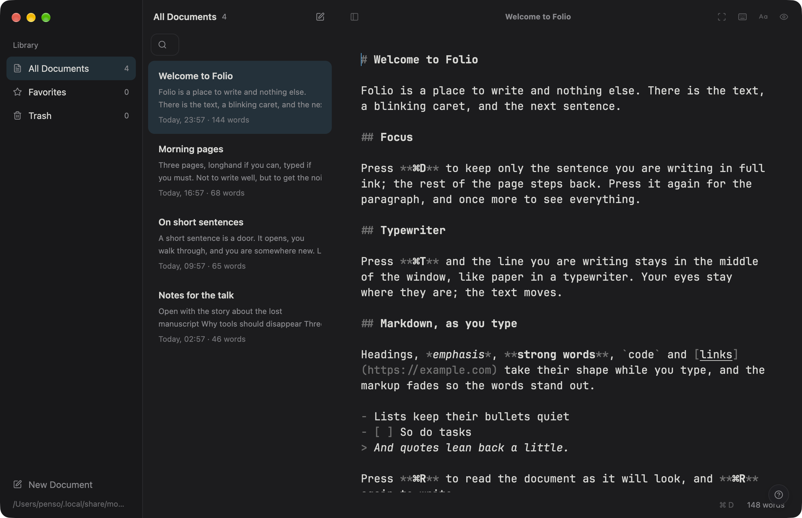
      <br>
      <sub><b>Folio</b> (<code>folio</code>): a quiet place to write: a library of markdown files beside a page that styles markdown as you type, with focus mode (the sentence or paragraph being written in full ink) and typewriter scrolling.</sub>
    </td>
  </tr>
</table>

Sessions, Workbench, Stage, Trellis and Lantern require the `projects`
package beside them (`examples/projects`). To run one by hand, link it in
place and open its profile:

```sh
cargo build --release -p moonframe-app
target/release/moonframe app link examples/ledger --yes
target/release/moonframe --profile ledger &
```

## Your own app, on the library

Profiles share the `moonframe` binary. An app with Rust of its own (or an
existing GPUI app moving over) depends on the `moonframe` crate instead,
and is a binary of its own:

```rust
fn main() -> std::process::ExitCode {
    moonframe::Moonframe::new("notes")            // ~/.config/notes, its state, its id
        .title("Notes")
        .app_dir(concat!(env!("CARGO_MANIFEST_DIR"), "/app"))
        .native("index", Index::default)          // a native provider: `app.index`
        .native_async("feed", Feed::default)      // one written with `async fn`, on tokio
        .view("editor", Editor::new)              // a GPUI view: `ui.view { name = "editor" }`
        .run()                                    // the window, --check, mod, app, bundle
}
```

Its `app/` folder is laid out like this repository's, and stands on
Moonframe's components, providers and stylesheet (compiled into the
library, so a git dependency needs no checkout beside it). `moonframe init
DIR` starts one, or adds the app folder, types and agent skills to an
existing crate; `cargo run --release -- bundle` builds its bundle.
Providers can be `async fn` on tokio, and views can await tokio futures:
it uses the app's own runtime (`.tokio(handle)`, or the one
`#[tokio::main]` runs it in), else makes one.
[examples/host](examples/host) is a small one, and
[docs/library.md](docs/library.md) has the rest.

## Commands

| Command | Does |
| --- | --- |
| `just run` | opens the window on `app/`, with `~/.config/moonframe` over it |
| `just check` | loads everything without a window and reports problems |
| `just types` | type-checks the Luau in strict mode |
| `just providers` | builds and lints the Wasm providers |
| `just bundle` | builds `target/bundle/Moonframe.app` |
| `just bundle-app NAME` | builds the profile NAME's app as a standalone release |
| `just check-examples` | loads and type-checks the apps in `examples/` |
| `just demo` | opens the gallery of every example app, to open and compare them |
| `just app` | lists the example apps; `just app NAME` opens one, and `just pilot` opens Pilot |
| `just patterns` | opens the independent pattern browser: categories, search, live previews and Luau source |
| `just patterns-check` | validates the patterns, their types and the generated web/native catalogs |
| `just install` | builds the app and installs it in `/Applications` |
| `just ci` | formatting, lints, tests, types, providers and check |
| `just audit` | zizmor and actionlint on the workflows, cargo-deny on the dependencies |
| `just release` | publishes `main` as the version in `Cargo.toml` |
| `just run-host` | opens the example app on the library, `examples/host` |

`moonframe --help` lists the app's own options, such as `--user DIR`,
`--no-user`, `--profile NAME`, `--check`, `--release`, and `--background`
(open without taking focus).

To see where time goes, run with `RUST_LOG=moonframe::perf=debug`: each
message, provider publish and frame is logged with how long it took and
which views it ran (`trace` adds each view's Luau and tree time). A message
runs only the views of the mods it reached, and a publish only those that
read that provider's data. Work slower than 8 ms is logged at `info` even
without it, and slower than 16 ms (a whole frame) at `warn`.

## License

[MIT](LICENSE).
