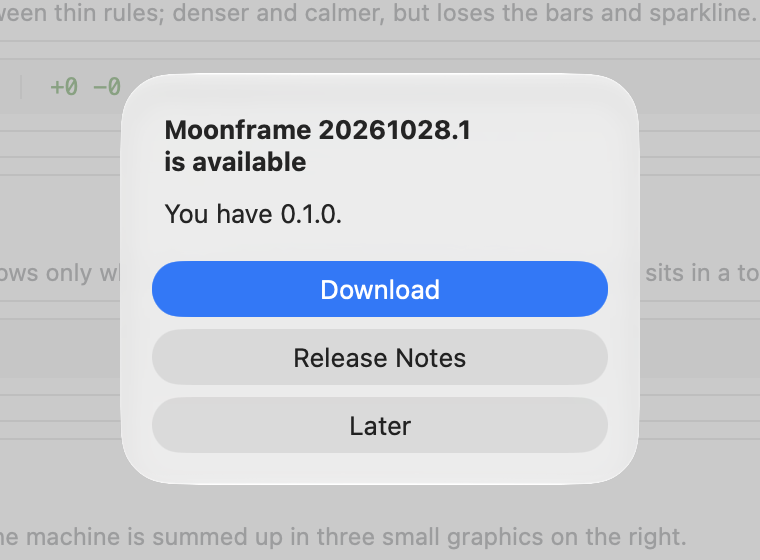

# Updates

An app on Moonframe can update itself from its GitHub releases. Name the
repository it is released from, and the app menu gets **Check for
Updates…**, under About:

- It asks GitHub for the repository's newest release
  (`/repos/OWNER/REPO/releases/latest`: published, not a draft or
  pre-release) and compares the release's tag with the running version.
- If the release is newer, a dialog offers it. On macOS, an app running from
  its own `.app` gets **Install and Relaunch**: the release's disk image (or
  zip) downloads, is checked against the release's `SHA256SUMS` when there is
  one, must hold an app with the same bundle id, signed by the same team as
  the running app, and takes the old app's place once it quits; then the
  new one opens, with the arguments the old one had (`--user`, `--profile`).
  If it cannot open (it needs a newer macOS, say), the old app goes back.
  One copy of the app installs at a time. Anywhere else (Linux, Windows, a run from source) the
  dialog offers **Download**, which opens the build for this platform in
  the browser, and **Release Notes**, which opens the release's page.
- An installed app (a bundle, a Linux install, or an app on the library
  built for release) also checks by itself once a day, at launch and while
  it stays open, whatever Developer Mode says, and says something only when
  there is a newer release. A check that cannot reach GitHub is tried again
  within the hour. Runs from source check only when asked.

The starter checks `moonframehq/moonframe`.



## Naming the repository

An app on the library names it, with its version:

```rust
moonframe::Moonframe::new("notes")
    .title("Notes")
    .version(env!("CARGO_PKG_VERSION"))
    .updates("example/notes")
    .run()
```

An app package (a profile) names it in `moonframe.toml`, with the version it
compares releases with; `just bundle-app NAME` writes that version into the
bundle too:

```toml
[app]
name = "notes"
title = "Notes"
version = "1.2.0"
updates = "example/notes"
```

A profile without `updates` has no Check for Updates: Moonframe's own
updates are the starter's. A profile running in the starter's `.app` (not a
bundle of its own) never replaces that `.app`; it opens the release instead.

A shell can also place the check itself, in a menu or on a button, with the
command `check-for-updates`:

```lua
{ title = "Help", items = { { label = "Check for Updates…", command = "check-for-updates" } } }
```

## Releasing your app

Moonframe writes the release files for you: each build as an archive named
for its version and platform, and `SHA256SUMS`, which the update is checked
against. Attach everything in the folder to a GitHub release tagged with the
version (`v1.2.3`).

**An app on the library** (its own crate, `moonframe init`):

```sh
cargo run --release -- bundle --dist dist
# dist/Notes-1.2.3-aarch64-apple-darwin.zip, dist/SHA256SUMS
gh release create v1.2.3 dist/*
```

**An app package** (a profile, `moonframe app new`), from a Moonframe
checkout:

```sh
just release-app notes            # or: DIST=dist scripts/bundle-app.sh target/bundle notes
gh release create v1.2.3 target/dist/*
```

Each run adds its build to the folder and its line to `SHA256SUMS`, so a
release can gather the Mac and Linux builds made on each system. On macOS
the archive is a zip of the `.app` (`universal-apple-darwin` when its binary
holds both architectures, built with `lipo`); on Linux a `.tar.gz` of the
prefix.

To release on each tag pushed, a workflow like this one is enough (an app
on the library; for an app package, check out Moonframe beside it and run
`just release-app` instead). Each system builds its archive; the last job
writes `SHA256SUMS` over all of them and publishes the release:

```yaml
# .github/workflows/release.yml
name: Release
on:
  push:
    tags: ["v*"]
permissions: {}
jobs:
  build:
    strategy:
      matrix:
        os: [macos-15, ubuntu-24.04]
    runs-on: ${{ matrix.os }}
    permissions:
      contents: read
    steps:
      - uses: actions/checkout@v4
      # Linux also needs GPUI's system packages: see Moonframe's
      # scripts/install-linux-deps.sh.
      - run: rustup target add wasm32-wasip2
      - run: cargo run --locked --release -- bundle --dist dist
      - uses: actions/upload-artifact@v4
        with:
          name: dist-${{ matrix.os }}
          path: dist/*
  release:
    needs: build
    runs-on: ubuntu-24.04
    permissions:
      contents: write
    steps:
      - uses: actions/download-artifact@v4
        with:
          pattern: dist-*
          path: dist
          merge-multiple: true
      - env:
          GH_TOKEN: ${{ github.token }}
        run: |
          cd dist && rm -f SHA256SUMS && sha256sum -- * > SHA256SUMS && cd ..
          gh release create "$GITHUB_REF_NAME" dist/* --repo "$GITHUB_REPOSITORY" --generate-notes
```

`macos-15` builds for Apple silicon only: Intel Macs find no build in that
release. For both, build each target and join the binaries with `lipo`
before bundling, as Moonframe's own `package.yml` does.

Moonframe itself releases through [releasing.md](releasing.md)'s workflow,
which publishes a disk image and the Linux and Windows archives named this
way, with `SHA256SUMS`; its Homebrew cask is marked `auto_updates`, so
`brew upgrade` leaves an app that updates itself alone.

### By hand

Any release that follows GitHub's usual path works:

1. Bump the version (`Cargo.toml`, or the manifest's `version`).
2. Tag the commit `v1.2.3` (the `v` is optional) and publish a release for
   the tag. Drafts and pre-releases are never offered.
3. Attach the builds, named for their platform:

   | Platform | Name it like | Picked by |
   | --- | --- | --- |
   | macOS | `Notes-1.2.3-universal-apple-darwin.dmg`, or a `.zip` naming the Mac (`darwin`, `macos`, `mac`) | `.dmg` first; `universal` or this Mac's architecture (`aarch64`/`arm64`, `x86_64`) |
   | Linux | `Notes-1.2.3-x86_64-unknown-linux-gnu.tar.gz`, `.AppImage` | `linux` and the architecture |
   | Windows | `Notes-1.2.3-x86_64-pc-windows-msvc.zip`, `.msi` | `windows`/`msvc` and the architecture |

   A build naming only another architecture is never picked.
4. Optionally attach `SHA256SUMS` (`sha256sum * > SHA256SUMS`): a download
   that does not match its line is refused.

The disk image must hold the `.app` at its top, with the same bundle id as
the running one (`dev.moonframe.app.NAME` for a profile's bundle) and a
signature `codesign --verify` accepts. When the running app is signed with
a Developer ID, the update must be signed by the same team: an update from
anyone else, or one signed ad hoc, is refused. An app signed ad hoc names no
signer to hold its updates to, so for it the checksum and bundle id are the
only checks: sign apps others download with a Developer ID (Gatekeeper
wants that and notarization anyway).
The app's folder must be writable by the user for the swap; when it is
not, the release's page opens instead.
