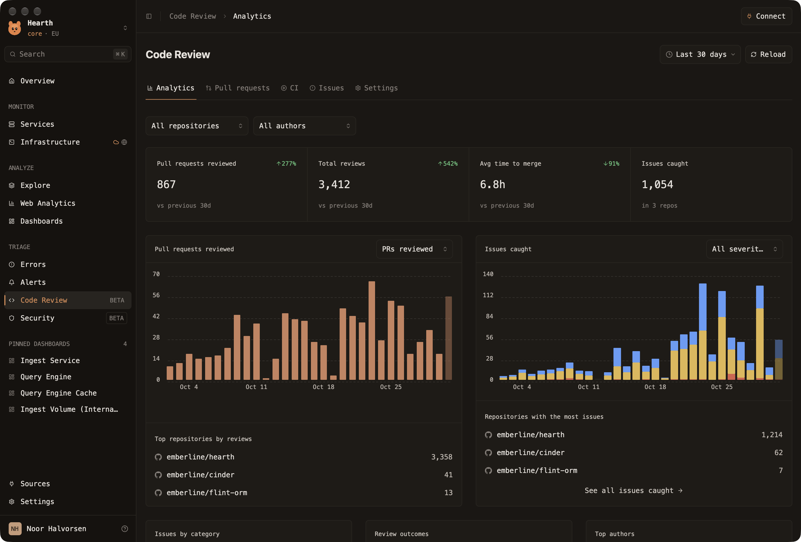

# Hearth

Code review analytics in an observability tool, on a warm black,
monospace page: how many pull requests the review bot read, how many issues
it caught and how bad they were, CI, and the repositories and people behind
them. All figures are **sample data** (`providers/hearth/sample.json`).



```sh
moonframe app link examples/hearth
moonframe --profile hearth
```

- **Sidebar** (`mods/sidebar`): org switcher with the mascot, search with
  ⌘K, Monitor / Analyze / Triage sections with Code Review marked by an
  orange edge and BETA tags, pinned dashboards, Sources, Settings and the
  signed-in user.
- **Top bar** (`mods/topbar`): sidebar toggle, `Code Review › <tab>`
  breadcrumbs (heard on the `hearth/tab` topic), Connect.
- **Page** (`mods/review`): title with the range and Reload, then tabs:
  - *Analytics*: repository and author selects, four key figures,
    pull requests reviewed per day (metric select) and issues caught
    stacked by severity (severity select) with hover tooltips on each bar
    and today's bar faded, top repositories, and issues by category,
    review outcomes and top authors.
  - *Pull requests*: the reviewed pull requests as `pr-row`s.
  - *CI*: figures, runner minutes per day and the latest runs.
  - *Issues*: open issues by severity, file and pull request.
  - *Settings*: the reviewer's switches and strictness.

It uses `bar-chart` with `ticks` (y labels and dashed gridlines), `grow`
and `dim` buckets, and `dropdown` with `chevron` and `trigger_width` for
select-style filters.
