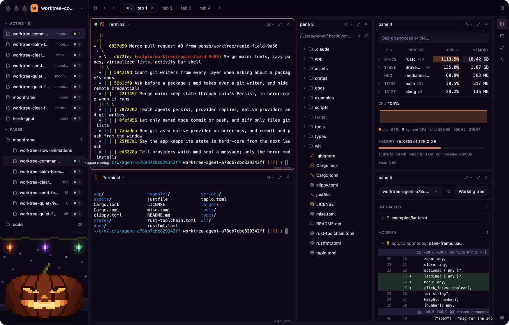

# Lantern

A Halloween terminal workspace on Moonframe: tabs of framed panes, pages of
projects, and a jack-o'-lantern under string lights.



- **Pages** (left): the open project and any with an agent running under
  ACTIVE, then every project grouped by its folder, with its changed files
  and a green pill for agents running in it. A click opens the project.
- **Tabs** (title row): each tab is its own grid of panes; `+` adds one.
- **Panes**: each is framed by the `pane-frame` component (icon, title, a
  menu of what it shows, zoom, close) and shows a live terminal, the
  project's files, the processes or the repository's changes. A click in a
  pane gives it the focus, drawn as an ember frame; the menu splits it
  right or down. The rail on the right switches what the focused pane
  shows.
- **Processes**: live from the app's own `procs` provider, native Rust
  built into the app (`crates/moonframe-procs`), which runs `ps`, `iostat`,
  `vm_stat` and `sysctl` (macOS): groups by name with heat bars, the CPU
  over the last two minutes, memory and pressure.
- **Changes**: from the built-in `git` provider, for the repository the app
  runs from: its worktrees, untracked and modified files, one diff open.
- **The Hallows palette** is in `style.luau`; the starter has it as the
  Hallows theme (View > Themes), which also colours terminals.
- **The night scene** is pixel art drawn by `art/draw.py` (plain Python, no
  packages), which also draws `icon.png`.

```sh
moonframe app link examples/lantern
moonframe --profile lantern
```

It requires [`../projects`](../projects) for the projects provider and the
`file-tree` component. Its `procs` provider runs commands with your access,
so linking asks to allow it.
