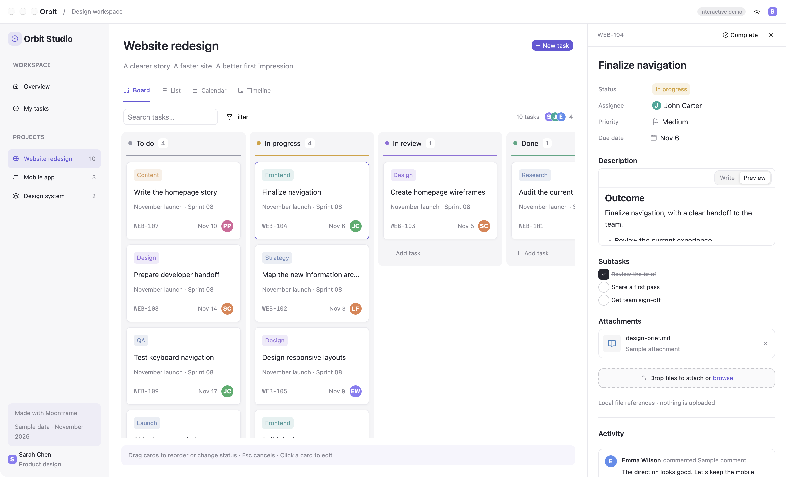

# Orbit

A working, local task-management demo for Moonframe, inspired by the calm
workspace layout of [Gr8r Studio](https://github.com/gr8rstudio/gr8r-studio)
and Asana: a project sidebar, connected views and an editable task panel.

```sh
# From this repository, after building Moonframe:
target/release/moonframe app link examples/orbit
target/release/moonframe --profile orbit
```

Orbit also appears automatically in the example-app gallery (`just demo`).
It needs no additional providers, accounts or services. The November 2026
tasks are **sample data**, saved locally by Moonframe as you edit them.



More screenshots: [dark mode](../../docs/screenshots/apps/orbit-dark.png),
[Overview](../../docs/screenshots/apps/orbit-overview.png),
[List](../../docs/screenshots/apps/orbit-list.png),
[Calendar](../../docs/screenshots/apps/orbit-calendar.png),
[Timeline](../../docs/screenshots/apps/orbit-timeline.png).

## Try it

- **Board:** drag cards within or between columns; Escape cancels a drag.
  Click a card to open its task panel. Add a task with **New task** or a
  column's **Add task** row.
- **List:** the same tasks in foldable status groups, with priority icons
  and assignees. Drag rows onto another row or a group heading.
- **Calendar:** month, week and day views; drag a task to move its due date
  (and its time in a week/day). Month arrows and Today use the demo date.
- **Timeline:** drag bars to shift dates, or their right edges to resize.
  Dependency arrows are drawn with `ui.paths` by `gantt`.
- **Task panel:** edit the title, pick a status, assignee, priority or due
  date, format the description and preview it, complete subtasks, attach
  local file references, write `@mentions`, post comments and add reactions.
- **Filter:** combine status, assignee, priority and text conditions with
  All/Any. Search works alongside the filters across every project view.
- **Overview:** project cards show live completion counts and let you star
  projects. **My tasks** shows Sarah's tasks across the workspace.
- The sun button switches light/dark appearance. ⌘/Ctrl-1…4 switches
  views, ⌘/Ctrl-0 opens Overview, and ⌘/Ctrl-N creates a task.
- **Links:** Orbit claims the `orbit:` scheme (`schemes` in its
  `moonframe.toml`), so once it is bundled (`just bundle-app orbit`) and
  opened once, `open 'orbit:/new?title=Call%20the%20printer'` (or the
  same link in a browser) adds a task and opens it, and
  `open 'orbit:/task?id=TASK-3'` opens that one. The workspace mod hears
  them on `app/url`.

Attachments are references to paths on this machine, not uploads. The
initial `design-brief.md` entries are labelled sample attachments. Comments
and reactions are local; the people are fictional demo members.

## Components on show

`project-card`, `kanban-column`, `board-card`, grouped/reorderable `table`,
`week-calendar`, `gantt`, `status-icon`, `priority-icon`, `picker`,
`date-picker`, `filter-builder`, `text-editor`, `mention-field`, `dropzone`,
`file-card`, `comment-card`, and `emoji-picker`.

The workspace mod owns the shared state. `orbit-views` and `orbit-detail`
compose the shipped components and send actions back to it. No host changes
are needed. The app's shell, styling, and every interaction are Luau.

```sh
just types examples/orbit
target/release/moonframe --profile orbit --check
cargo test -p moonframe-core orbit
```
