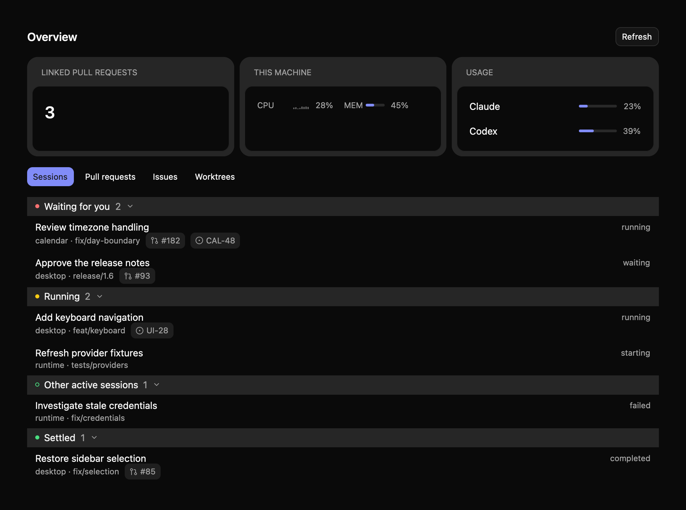

# T3 Overview

A Moonframe app for the sessions in a local T3 Code environment. Fold a group or click a session to see its provider, worktree and last update. Click a PR or issue badge to open it in the browser. The tabs filter sessions to those with linked pull requests, issues or worktrees. The machine and usage cards read Moonframe's system and usage providers.



## Run it

With T3 Code running locally, run these commands from the Moonframe checkout. Setup uses the T3 CLI to issue a token scoped to `orchestration:read`. Python 3 runs the provider. This flow has been tested with T3 Code 0.1.11.

```sh
python3 app/providers/t3/t3.py --connect
cargo run --locked -p moonframe-app -- app link examples/t3-overview
cargo run --locked -p moonframe-app -- --profile t3-overview app
```

Setup saves the token privately in `$T3CODE_HOME/moonframe-token.json`. The default home is `~/.t3`. If a Sheprd pairing already exists for this environment, skip setup and launch Moonframe with `MOONFRAME_T3_TOKEN_FILE` set to the file created by `sheprd-t3 pair --token-file FILE`. The provider checks the environment ID before sending a token and discovers the loopback origin from T3's runtime file. Run setup again when the Moonframe token expires.

## Build another overview

Read `app.t3` in a mod's view. Moonframe starts the provider on demand. Subscribe to `provider/t3` when the mod's update function also needs to hear about changes.

```luau
local sessions = use "t3-sessions"

-- Inside view(state, app)
local data = app.t3
if not data then return ui.text "Connecting…" end
if not data.available then return ui.text(data.error or "Unavailable") end
return sessions { threads = data.threads, folded = state.folded, selected = state.selected }
```

Handle `{ fold = group }` and `{ thread = id }` in the mod. Use `use "t3-thread"` for a single row. The provider polls every 15 seconds, publishes changes, and refreshes immediately on `send "provider:t3" "refresh"`.

`app.t3` contains `available`, optional `error`, `total` and `threads`. Each row carries its ID, title, project, raw T3 status, display group, update timestamp, optional provider, branch and worktree, and lists of PR and issue links with labels, titles and URLs. Waiting means a blocking request, a proposed plan needing action, or a pending guest message. Settled reflects T3's explicit settlement flag. Other active sessions include completed runs still on the active list. Raw status stays visible for failed and interrupted runs.

The provider requests the active v2 shell snapshot, omits archived and deleted threads, and publishes the newest 200 sessions within Moonframe's message-size limit. Each row shows up to four PR and four issue labels. Counts and filters in the example apply to the published rows. The integration uses Moonframe's existing process-provider protocol and requires no WIT changes.
