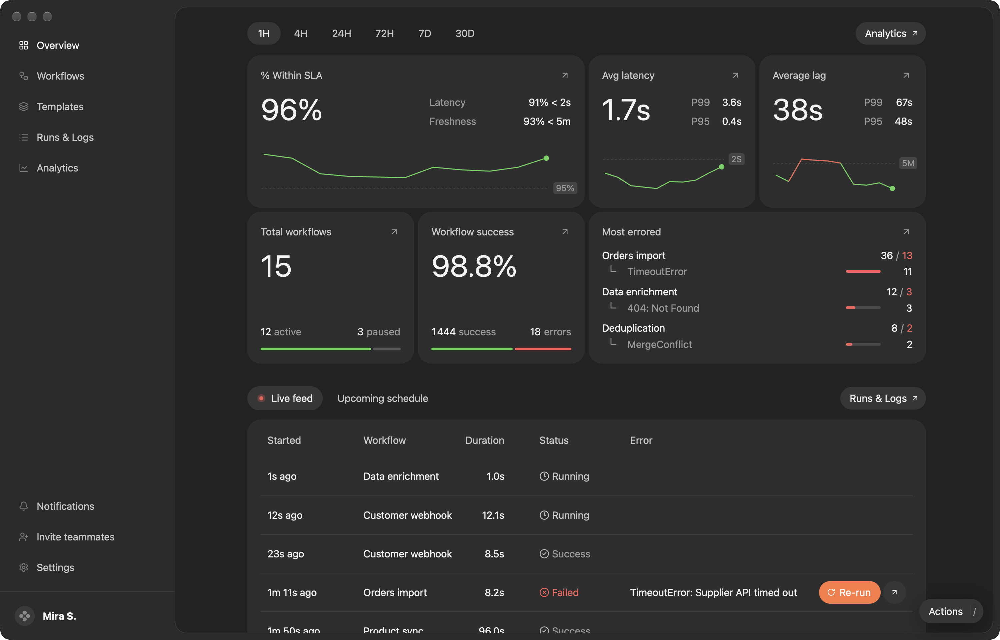

# Vigil

A dark workflow-operations dashboard: how much ran within SLA, average
latency and lag against their limits, workflows active and paused, success
against errors, the workflows that fail most, and a live feed of runs.



```sh
moonframe app link examples/vigil
moonframe --profile vigil
```

- **Live.** The `vigil` provider (Rust built to WebAssembly,
  `providers/vigil`) publishes once a second: a run starts every few
  seconds, running ones finish (now and then with an error), finished runs
  count towards the success figures, and the charts' latest points drift. The red dot beside Live feed breathes on
  each tick.
- **Range.** 1H to 30D switch the figures (a message to the provider, kept
  across launches). The View menu has them too.
- **Re-run.** A failed run's orange button starts its workflow again; the
  new run appears at the top of the feed.
- **Upcoming schedule.** The tab beside Live feed counts down to each
  workflow's next run.
- **Actions.** The pill in the corner (or ⌘/) opens a menu: re-run the last
  failure, switch the tab or the range.

The figures are SAMPLE DATA from `providers/vigil/sample.json`; point the
provider at your orchestrator's API to make it real. The charts use the
`threshold-line` component (a trend against a dashed, labelled limit, with
breaches in red).
